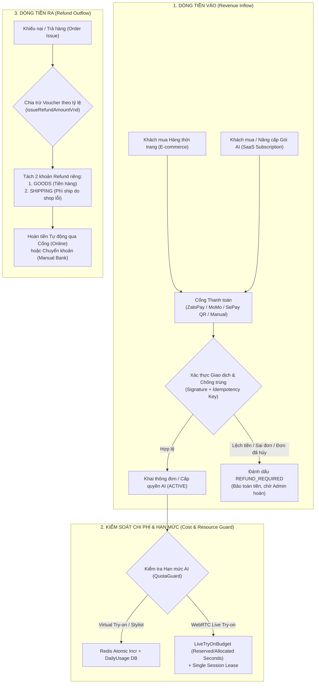
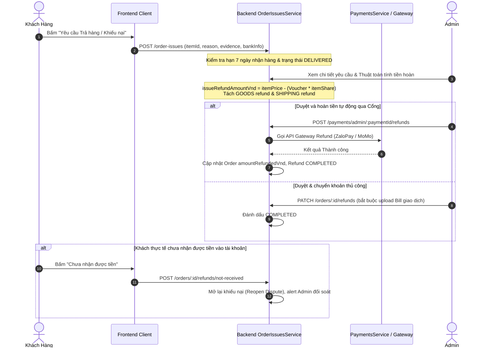

# Hướng Dẫn Nghiệp Vụ Tài Chính, Thanh Toán & Kịch Bản Demo - FashionAI

Tài liệu này tổng hợp toàn bộ kiến trúc dòng tiền, các luồng nghiệp vụ nhạy cảm liên quan đến thanh toán, đơn hàng, gói trả phí (SaaS Subscription), hoàn tiền, chống gian lận, cùng bộ câu hỏi vấn đáp chuyên sâu và 3 kịch bản demo thực chiến cho dự án **FashionAI**.

---

## MỤC LỤC
1. [Tổng Quan Kiến Trúc Dòng Tiền & 3 Bất Biến Tài Chính](#1-tổng-quan-kiến-trúc-dòng-tiền--3-bất-biến-tài-chính)
2. [Phân Tích 4 Luồng Nghiệp Vụ Cốt Lõi](#2-phân-tích-4-luồng-nghiệp-vụ-cốt-lõi)
   - [2.1 Luồng Gói Trả Phí (AI SaaS Subscription) & Tính Tiền Giữa Kỳ (Proration)](#21-luồng-gói-trả-phí-ai-saas-subscription--tính-tiền-giữa-kỳ-proration)
   - [2.2 Luồng Thanh Toán Đa Cổng & Cơ Chế Chống Trùng (Idempotency & Resilience)](#22-luồng-thanh-toán-đa-cổng--cơ-chế-chống-trùng-idempotency--resilience)
   - [2.3 Luồng Hoàn Tiền, Đổi Trả & Thuật Toán Chống Trục Lợi Voucher](#23-luồng-hoàn-tiền-đổi-trả--thuật-toán-chống-trục-lợi-voucher)
   - [2.4 Luồng Đơn Hàng May Đo & Định Giá Authoritative Backend](#24-luồng-đơn-hàng-may-đo--định-giá-authoritative-backend)
3. [Bộ Câu Hỏi Vấn Đáp / Bảo Vệ Đồ Án Chuyên Sâu](#3-bộ-câu-hỏi-vấn-đáp--bảo-vệ-đồ-án-chuyên-sâu)
   - [Nhóm 1: Câu hỏi về Code & Kiến trúc nội tại](#nhóm-1-câu-hỏi-về-code--kiến-trúc-nội-tại)
   - [Nhóm 2: Câu hỏi Tình huống & Sự cố Biên (Edge Cases & Concurrency)](#nhóm-2-câu-hỏi-tình-huống--sự-cố-biên-edge-cases--concurrency)
   - [Nhóm 3: Câu hỏi Mở rộng về Fintech / System Design](#nhóm-3-câu-hỏi-mở-rộng-về-fintech--system-design)
4. [Kịch Bản Demo 3 Luồng Thực Chiến (Luồng Mua Bán Đặt Cuối)](#4-kịch-bản-demo-3-luồng-thực-chiến-luồng-mua-bán-đặt-cuối)
   - [Kịch bản 1: SaaS AI Subscription, Quota & Nâng Cấp Proration Giữa Kỳ](#kịch-bản-1-saas-ai-subscription-quota--nâng-cấp-proration-giữa-kỳ)
   - [Kịch bản 2: Hậu Mãi, Khiếu Nại & Hoàn Tiền Thông Minh (Anti-Voucher Exploit)](#kịch-bản-2-hậu-mãi-khiếu-nại--hoàn-tiền-thông-minh-anti-voucher-exploit)
   - [Kịch bản 3: Đặt Hàng May Đo (Made-to-Measure), Thanh Toán & Tự Động Hóa GHN](#kịch-bản-3-đặt-hàng-may-đo-made-to-measure-thanh-toán--tự-động-hóa-ghn)

---

## 1. TỔNG QUAN KIẾN TRÚC DÒNG TIỀN & 3 BẤT BIẾN TÀI CHÍNH

FashionAI áp dụng mô hình **Hybrid: E-commerce Thời trang + B2C AI SaaS**. Hệ thống có sự đan xen giữa dòng tiền bán hàng vật lý (phí ship, may đo, hoàn trả hàng) và dòng tiền dịch vụ số (bán lượt dùng AI, gói thuê bao tháng, chi phí GPU).



### 3 Bất Biến Tài Chính (Invariants) cốt lõi:
1. **Toàn quyền định giá thuộc về Backend (Backend-authoritative):** Client không bao giờ được gửi `totalAmount`, `shippingFee`, hay `discountAmount`. Mọi số tiền đều được tính toán lại từ Database (`Product.price`, `SaleCampaign`, `Coupon`, và GHN API).
2. **Nguyên tắc "Mỗi User chỉ có tối đa 1 Subscription ACTIVE":** Đảm bảo qua PostgreSQL Partial Unique Index `subscriptions_one_active_per_user` và cơ chế cộng dồn chu kỳ (`RENEWED`).
3. **Tiền vào không bao giờ biến mất (No Money Lost):** Khi Webhook báo tiền đã trừ ở cổng nhưng đơn hàng bên mình đã bị hủy do quá hạn 24h (`INVALID_ORDER_STATUS`), hệ thống **không bỏ qua (drop)** mà tự động chuyển sang `REFUND_REQUIRED` với scope `PAYMENT_ONLY` để Admin hoàn tiền cho khách.

---

## 2. PHÂN TÍCH 4 LUỒNG NGHIỆP VỤ CỐT LÕI

### 2.1 Luồng Gói Trả Phí (AI SaaS Subscription) & Tính Tiền Giữa Kỳ (Proration)
*Tham chiếu mã nguồn:* `src/modules/payments/subscription.service.ts`, `src/common/constants/subscription-plans.constants.ts`.

#### 1. Các gói cước:
* `FREE`: 0 VNĐ. Thử đồ: 0 lượt. Tư vấn stylist: 3 lượt/ngày. Chat: 50 tin/ngày.
* `MEMBER`: 34.000 VNĐ / 30 ngày. Thử đồ: 5 lượt/ngày. Stylist: 20 lượt/ngày. Chat: 200 tin/ngày.
* `VIP`: 99.000 VNĐ / 30 ngày. Thử đồ: 10 lượt/ngày. Stylist & Chat: Không giới hạn. Mở khóa Live Try-on WebRTC.

#### 2. Nghiệp vụ Gia hạn (RENEWAL):
Khách đang có gói `ACTIVE` và mua lại đúng gói đó. Hệ thống không tạo thêm dòng `ACTIVE` (sẽ vi phạm partial index), mà thực hiện:
* Cập nhật dòng `ACTIVE` hiện tại: `expiresAt = currentSub.expiresAt + 30 days`.
* Tạo 1 bản ghi `Subscription` mới mang trạng thái `RENEWED` gắn `orderId` mới để lưu vết lịch sử giao dịch.

#### 3. Nghiệp vụ Nâng cấp giữa kỳ (UPGRADE với Proration):
* Nếu khách từ `MEMBER` nâng lên `VIP` khi còn `remainingDays`:
  $$\text{Credit (tiền chưa dùng gói cũ)} = \text{roundUpVnd}\left(\frac{34.000 \times \text{remainingDays}}{30}\right)$$
  $$\text{Debit (tiền tương ứng gói mới)} = \text{roundUpVnd}\left(\frac{99.000 \times \text{remainingDays}}{30}\right)$$
  $$\text{Net (khách cần thanh toán)} = \max(\text{Debit} - \text{Credit}, 0)$$
* **Bảo vệ chống trượt giá:** Quote được đóng băng trong `Order.prorationSnapshot` với hạn 24h (`PRORATION_QUOTE_MAX_AGE_MS`). Nếu sau 24h khách mới thanh toán, hệ thống quy đổi động số ngày cấp:
  $$\text{grantedDays} = \min\left(\max\left(\text{round}\left(\frac{\text{paidVnd}}{\text{VIP\_PRICE}} \times 30\right), 1\right), 30\right)$$

#### 4. Nghiệp vụ Xuống gói (DOWNGRADE):
* Tạo bản ghi `SCHEDULED` bắt đầu từ ngày gói hiện tại hết hạn (`startsAt = currentSub.expiresAt`).
* Không hoàn tiền gói cũ, gói cũ vẫn chạy bình thường đến hết hạn.

#### 5. Kiểm soát Quota và chi phí GPU:
* **Virtual Try-on (fal.ai FASHN):** `QuotaGuard` gọi `QuotaService.assertQuota` $\rightarrow$ Đọc Redis `quota:<action>:<userId>:<date>`. Nếu chưa có, query Postgres `daily_usages` rồi set Redis có TTL đến nửa đêm.
  * Hết lượt: HTTP 429 `QUOTA_EXCEEDED`.
  * Gói FREE thử đồ: HTTP 402 `PAYMENT_REQUIRED`.
* **Live Try-on WebRTC (Decart Realtime):** Dùng `LiveTryOnBudget` (`reservedSeconds`, `allocatedSeconds`) kết hợp `LiveTryOnLease` để đảm bảo mỗi user chỉ có đúng 1 session WebRTC chạy đồng thời, tự giải phóng tài nguyên sau khi timeout.

---

### 2.2 Luồng Thanh Toán Đa Cổng & Cơ Chế Chống Trùng (Idempotency & Resilience)
*Tham chiếu mã nguồn:* `src/modules/payments/payments.service.ts`, `src/modules/payments/utils/payment-keys.util.ts`.

#### 1. Đa cổng thanh toán:
* **ZaloPay:** Tích hợp `zalopay-sdk`, tạo đơn có `app_trans_id`, URL chuyển hướng chứa `paymentId` để FE poll kết quả.
* **MoMo:** Ký request qua HMAC SHA256, xử lý IPN callback bất đồng bộ.
* **SePay:** Quét biến động số dư VietQR qua IPN/Bank Webhook.
* **Manual Admin:** Xác nhận chuyển khoản thủ công, bắt buộc có bằng chứng hóa đơn.

#### 2. Cơ chế Chống trùng (Idempotency):
* **Tầng Webhook:** Lưu vào bảng `WebhookEvent` với `eventKey` unique (dựa trên Transaction ID của cổng). Nếu cổng bắn lại cùng 1 event, Prisma ném lỗi `P2002`, hệ thống lập tức trả lời HTTP 200 / `DUPLICATE` mà không chạy lại logic cộng tiền.
* **Tầng OrderEvent:** Sử dụng `deduplicationKey` unique toàn hệ thống (ví dụ `payment:ZALOPAY:<transId>`).
* **Tầng Manual Admin:** Gán `paymentTransactionId` dạng `orderCode:reference` để phân tách riêng từng đơn, tránh trường hợp 2 đơn có cùng ghi chú chuyển khoản đè lên nhau.

#### 3. Xử lý Lỗi & Tự Phục Hồi (Auto Reconciliation):
* **Cron Reconcile (mỗi 1 phút):** `PaymentsService.reconcileGatewayPayments` sử dụng Redis lock, tự động gọi API query trạng thái từ MoMo/ZaloPay cho các payment bị kẹt `PENDING` (do rớt mạng khi callback).
* **Đơn quá hạn (mỗi 10 phút):** `OrdersService.expireUnpaidOrders` quét các đơn chưa thanh toán quá 24h, tự động chuyển `status: CANCELLED` và giải phóng lại lượt dùng Voucher (`releaseOrderCouponRedemption`).

---

### 2.3 Luồng Hoàn Tiền, Đổi Trả & Thuật Toán Chống Trục Lợi Voucher
*Tham chiếu mã nguồn:* `src/modules/order-issues/`, `src/modules/order-issues/utils/issue-refund-amount.util.ts`.



#### Thuật toán Phân Bổ Voucher Theo Tỷ Lệ:
* **Nguy cơ:** Khách mua Áo 400k + Váy 600k = 1.000k, áp mã giảm 200k. Sau đó khách trả Áo và đòi hoàn đủ 400k.
* **Giải pháp trong [issue-refund-amount.util.ts](file:///d:/EXE_Project/FashionAI_BE/src/modules/order-issues/utils/issue-refund-amount.util.ts):**
  $$\text{itemShare} = \frac{\text{lineTotalVnd}}{\text{subtotalVnd}} = \frac{400\text{k}}{1.000\text{k}} = 0.4$$
  $$\text{discountShare} = 200\text{k} \times 0.4 = 80\text{k}$$
  $$\text{Tiền hoàn hàng (GOODS)} = 400\text{k} - 80\text{k} = 320\text{k}$$
* **Phí vận chuyển (SHIPPING):** Nếu lý do trả hàng thuộc lỗi của shop (`WRONG_SIZE`, `WRONG_COLOR`, `QUALITY_MISMATCH`), hệ thống cho phép hoàn thêm 100% phí ship ban đầu dưới một bản ghi `Refund` riêng biệt (`kind: 'SHIPPING'`).

---

### 2.4 Luồng Đơn Hàng May Đo & Định Giá Authoritative Backend
*Tham chiếu mã nguồn:* `src/modules/orders/orders.service.ts`, `src/modules/shipping/shipping.service.ts`.

#### 1. Định giá Authoritative:
Client gọi `POST /orders/quote` để xem trước, nhưng khi bấm `POST /orders`, toàn bộ số tiền được định giá lại độc lập tại backend:
$$\text{Total} = \sum (\text{SalePrice}) + \text{Phí GHN có bảo hiểm} - \text{Discount Amount}$$
* Bảo hiểm hàng hóa GHN: Tự động khai báo `insuranceValue = itemsTotal` để đảm bảo đơn hàng được đền bù thỏa đáng nếu thất lạc.

#### 2. Quy trình may đo (Made-to-Measure):
Đơn hàng chứa sản phẩm may đo sẽ không chuyển ngay sang `PROCESSING` mà đi qua `MEASUREMENT_REVIEW`:
1. Stylist/Admin kiểm tra số đo AI (ngực, eo, mông, chiều cao, cân nặng).
2. Nếu số đo bất thường, bấm yêu cầu khách cập nhật lại (`requestMeasurementReview`).
3. Khách cập nhật số đo $\rightarrow$ Admin duyệt $\rightarrow$ Mới chuyển sang xưởng cắt may (`PROCESSING`).

#### 3. Outbox Pattern gửi đơn GHN:
Khi đơn chuyển sang `READY_TO_SHIP`, thông tin vận đơn được ghi vào bảng `OutboxEvent` trong cùng database transaction. BullMQ worker (`OutboxProcessor`) sẽ đảm nhận việc gọi sang API GHN, giúp hệ thống không bị nghẽn mạng nếu GHN phản hồi chậm.

---

## 3. BỘ CÂU HỎI VẤN ĐÁP / BẢO VỆ ĐỒ ÁN CHUYÊN SÂU

### Nhóm 1: Câu hỏi về Code & Kiến trúc nội tại

#### Q1: Tại sao trong Prisma Schema, các trường tiền tệ như `itemsSubtotalVnd`, `totalVnd`, `amountPaidVnd` lại dùng kiểu `BigInt` thay vì `Float` hay `Decimal`?
* **Đáp án chuẩn:**
  * `Float` trong JavaScript (chuẩn IEEE 754) có sai số dấu phẩy động (floating-point error, ví dụ `0.1 + 0.2 = 0.30000000000000004`). Trong tài chính, việc lệch dù chỉ 1 đồng cũng làm hỏng việc kiểm tra chữ ký số HMAC của cổng thanh toán hoặc làm sai lệch sổ sách kế toán.
  * Tiền tệ Việt Nam (VND) không có phần thập phân (không có xu/hào). `BigInt` lưu số nguyên tuyệt đối, an toàn 100% cho các phép tính số học và ánh xạ trực tiếp sang kiểu `BIGINT` trong cơ sở dữ liệu PostgreSQL.

#### Q2: Làm thế nào để đảm bảo một người dùng không bao giờ sở hữu 2 gói `ACTIVE` cùng một lúc khi có 2 Webhook thanh toán gửi đến gần như đồng thời?
* **Đáp án chuẩn:**
  * Ở tầng Database: Sử dụng PostgreSQL Partial Unique Index:
    ```sql
    CREATE UNIQUE INDEX subscriptions_one_active_per_user 
    ON subscriptions (user_id) WHERE status = 'ACTIVE';
    ```
  * Ở tầng Service (`subscription.service.ts`): Trước khi tạo mới, service kiểm tra gói hiện tại. Nếu cùng gói, nó kích hoạt luồng `RENEWAL` (cộng dồn hạn sử dụng vào dòng `ACTIVE` cũ và tạo dòng mới dạng `RENEWED`). Nếu là luồng mua mới, nó cập nhật đóng dòng cũ trước khi mở dòng mới. Nếu có race condition 2 request đồng thời cố tạo 2 dòng `ACTIVE`, DB sẽ ném lỗi `P2002` (Unique Constraint Violation) và transaction bị rollback ngay.

#### Q3: Khi đơn hàng được áp mã giảm giá, nếu khách trả lại 1 món trong đơn thì tính tiền hoàn thế nào để khách không trục lợi?
* **Đáp án chuẩn:**
  * Hệ thống sử dụng thuật toán phân bổ tỷ lệ trong [issue-refund-amount.util.ts](file:///d:/EXE_Project/FashionAI_BE/src/modules/order-issues/utils/issue-refund-amount.util.ts).
  * Tiền hoàn của món hàng = Giá món hàng - (Tổng voucher $\times$ Tỷ lệ giá trị của món trên tổng đơn).
  * Điều này triệt tiêu hoàn toàn chiêu trò "mua kèm đồ đắt tiền để đủ điều kiện áp voucher lớn, rồi trả lại món đắt tiền để hưởng trọn voucher".

---

### Nhóm 2: Câu hỏi Tình huống & Sự cố Biên (Edge Cases & Concurrency)

#### Q4: Điều gì xảy ra nếu khách hàng đã thanh toán thành công bên ví điện tử ZaloPay, nhưng do sự cố mạng, 25 tiếng sau Webhook mới bắn về backend trong khi Cron đã hủy đơn (quá 24h)? Tiền của khách đi đâu?
* **Đáp án chuẩn:**
  * Khi Webhook bắn về, hàm `processOrderSuccess` phát hiện đơn hàng đã mang trạng thái `CANCELLED` (`INVALID_ORDER_STATUS`).
  * Hệ thống không bỏ rơi giao dịch! Hàm `markRefundRequiredIfCollected` sẽ:
    1. Cập nhật `Payment.status = REFUND_REQUIRED`.
    2. Ghi chú metadata `refundScope = 'PAYMENT_ONLY'` và lưu số tiền cổng đã thu thực tế.
    3. Ghi log sự kiện vào `OrderEvent`.
  * Giao dịch này xuất hiện trong danh sách đối soát của Admin (`GET /payments/admin/unmatched-transactions`) để Admin kích hoạt hoàn tiền tự động qua API cổng ZaloPay về lại ví cho khách mà không làm sai lệch số liệu tồn kho hay đơn hàng.

#### Q5: Khách hàng mở cùng lúc 5 tab trình duyệt và bấm "Thử đồ ảo AI" cùng một lúc để lách hạn mức 5 lượt/ngày của gói Member. Hệ thống ngăn chặn thế nào?
* **Đáp án chuẩn:**
  * Trong [quota.service.ts](file:///d:/EXE_Project/FashionAI_BE/src/common/services/quota.service.ts), hệ thống sử dụng lệnh nguyên tử của Redis (`INCRBY` / Atomic Increment) kết hợp với `QuotaGuard`.
  * Thao tác kiểm tra và tăng số lượng trên Redis là đơn luồng (single-threaded atomic operation). Request thứ 6 dù đến chỉ sau vài mili-giây cũng sẽ thấy `count > limit` và lập tức bị chặn với mã lỗi HTTP 429 `QUOTA_EXCEEDED` trước khi bất kỳ tác vụ AI đắt đỏ nào kịp chạy.

#### Q6: Tại sao hệ thống lại cho phép khách hàng bấm nút "Chưa nhận được tiền" (`reopenRefundNotReceived`) sau khi Admin đã báo hoàn tất chuyển khoản?
* **Đáp án chuẩn:**
  * Đối với hình thức hoàn tiền chuyển khoản tay (`MANUAL_ADMIN`), có trường hợp Admin chuyển nhầm số tài khoản, sai tên người thụ hưởng hoặc ngân hàng bị treo giao dịch (pending).
  * Nút này là cơ chế bảo vệ khách hàng (Customer Protection). Khi bấm, hệ thống chuyển khiếu nại về trạng thái `REOPENED`, ghi sự kiện vào `OrderEvent` và gửi thông báo khẩn cho Admin kiểm tra lại sao kê ngân hàng.

---

### Nhóm 3: Câu hỏi Mở rộng về Fintech / System Design

#### Q7: Tại sao không cập nhật đơn hàng thành "ĐÃ THANH TOÁN" ngay khi người dùng được chuyển hướng về trang Success URL (Return URL), mà bắt buộc phải đợi Webhook/IPN?
* **Đáp án chuẩn:**
  * Return URL đi qua trình duyệt người dùng. Kẻ gian hoàn toàn có thể can thiệp bằng cách chặn bắt gói tin hoặc sửa query params trên URL (ví dụ sửa `status=1` thành `status=0`) để giả mạo thanh toán thành công mà không hề trả tiền.
  * Webhook/IPN là giao tiếp trực tiếp Server-to-Server (Backend-to-Backend). Nó đi kèm chữ ký số bí mật (Secret HMAC) mà chỉ có Cổng thanh toán và Backend của ta nắm giữ. Chỉ khi Backend xác thực chữ ký này thành công thì đơn hàng mới được coi là hợp lệ.

#### Q8: Nếu hệ thống gửi yêu cầu hoàn tiền sang ZaloPay nhưng ZaloPay bị timeout 30 giây không phản hồi, bạn xử lý thế nào để tránh hoàn 2 lần?
* **Đáp án chuẩn:**
  * Khi khởi tạo yêu cầu hoàn tiền, hệ thống sinh một mã duy nhất `idempotencyKey` (UUID) và lưu bản ghi `Refund` ở trạng thái `PROCESSING`.
  * Nếu timeout, hệ thống giữ nguyên trạng thái `PROCESSING`, tuyệt đối không gọi lại ngay.
  * Cron job `reconcileGatewayPayments` (chạy mỗi phút) sẽ dùng đúng `requestId / idempotencyKey` đó để gọi API tra cứu trạng thái hoàn tiền (`queryRefund`) của ZaloPay. Nếu ZaloPay báo đã hoàn, cập nhật `COMPLETED`. Nếu báo chưa từng nhận được yêu cầu, hệ thống mới cho phép thử lại một cách an toàn.

---

## 4. KỊCH BẢN DEMO 3 LUỒNG THỰC CHIẾN (LUỒNG MUA BÁN ĐẶT CUỐI)

> **Chiến lược dẫn dắt buổi Demo:** Mở đầu trực diện bằng tính năng SaaS AI đột phá $\rightarrow$ Đi vào luồng Hậu mãi hoàn tiền chống gian lận $\rightarrow$ Khép lại bằng luồng Đặt hàng May đo truyền thống. Hội đồng sẽ ấn tượng ngay từ phút đầu!

---

### 🎬 Kịch bản 1: SaaS AI Subscription, Quota & Nâng Cấp Proration Giữa Kỳ
*Thời lượng dự kiến: 3 - 4 phút*

| Bước | Hành động của Bạn | Kết quả Hiển thị trên Màn hình | Lời thoại Thuyết minh với Hội đồng |
| :--- | :--- | :--- | :--- |
| **1. Chặn tài khoản FREE** | Đăng nhập tài khoản `FREE`. Vào mục **Thử đồ AI** hoặc **Live Try-on**, chọn đồ và bấm Thử. | Popup cảnh báo: *"Tính năng Thử đồ yêu cầu gói trả tiền. Vui lòng nâng cấp tài khoản!"* (Mã lỗi HTTP 402). | *"Hệ thống bảo vệ chi phí GPU bằng QuotaGuard. Tài khoản miễn phí bị chặn hoàn toàn các tính năng AI tốn phí cao."* |
| **2. Mua gói Member** | Vào bảng giá, chọn gói **Member (34.000đ/tháng)**. Chọn thanh toán VietQR / ZaloPay. | Quét mã thanh toán $\rightarrow$ Webhook kích hoạt $\rightarrow$ Tài khoản lên hạng `MEMBER`, cấp 5 lượt thử đồ/ngày. | *"Thanh toán được xác thực qua Webhook có chữ ký số. Hệ thống cấp quyền ACTIVE và khởi tạo bộ đếm Quota trên Redis."* |
| **3. Dùng thử hạn mức** | Bấm thử 1 bộ đồ thành công. Mở trang cá nhân kiểm tra. | Số lượt còn lại giảm từ 5/5 xuống **4/5 lượt**. | *"Lượt dùng được trừ nguyên tử (atomic) trên Redis và định kỳ sync xuống bảng `daily_usages` trong Postgres."* |
| **4. Nâng cấp Proration (Điểm sáng!)** | Bấm nâng cấp lên gói **VIP (99.000đ/tháng)** khi gói Member còn 20 ngày sử dụng. | Màn hình hiển thị số tiền thanh toán: **Chỉ 44.000đ** (thay vì 99.000đ). | *"Hệ thống tự động tính toán Proration: Khấu trừ số ngày chưa dùng của gói Member và chỉ thu tiền chênh lệch của gói VIP. Sau khi thanh toán, user được nâng lên VIP ngay lập tức."* |

---

### 🎬 Kịch bản 2: Hậu Mãi, Khiếu Nại & Hoàn Tiền Thông Minh (Anti-Voucher Exploit)
*Thời lượng dự kiến: 3 - 4 phút*

| Bước | Hành động của Bạn | Kết quả Hiển thị trên Màn hình | Lời thoại Thuyết minh với Hội đồng |
| :--- | :--- | :--- | :--- |
| **1. Khách tạo khiếu nại** | Mở đơn hàng đã giao (`DELIVERED`) gồm 2 món: Áo Blazer (600k) + Quần Tây (400k), đã dùng Voucher giảm 100k. Chọn món Quần Tây $\rightarrow$ Bấm **"Yêu cầu Đổi trả / Khiếu nại"**. | Form gửi yêu cầu: Chọn lý do `WRONG_SIZE`, tải ảnh chứng minh lỗi, điền số tài khoản ngân hàng. | *"Khách hàng có quyền khiếu nại trong vòng 7 ngày kể từ khi nhận hàng theo đúng chính sách đổi trả."* |
| **2. Admin duyệt & Thuật toán chống trục lợi** | Chuyển sang tài khoản Admin, mở `/admin/order-issues`. Bấm xem chi tiết yêu cầu khiếu nại. | Hệ thống đề xuất số tiền hoàn: **360.000đ** (chứ không phải 400.000đ) + Gợi ý tích chọn hoàn 30.000đ phí ship. | *"Hệ thống áp dụng thuật toán chia trừ voucher theo tỷ lệ giá trị sản phẩm. Khách mua quần 400k (40% đơn) thì bị trừ 40k voucher, chỉ được hoàn 360k. Đồng thời vì lỗi do shop, hệ thống đề xuất hoàn luôn phí ship ban đầu."* |
| **3. Thực hiện hoàn tiền** | Admin bấm xác nhận hoàn tiền qua cổng thanh toán ZaloPay (hoặc upload bill chuyển khoản). | Trạng thái Refund chuyển sang `COMPLETED`. Tiền hoàn được cập nhật vào `amountRefundedVnd` của đơn. | *"Hệ thống gọi API hoàn tiền trực tiếp của cổng thanh toán có gắn Idempotency Key chống trùng lặp."* |
| **4. Khách khiếu nại "Chưa nhận tiền"** | Quay lại tài khoản Khách, bấm nút **"Chưa nhận được tiền hoàn"**. | Khiếu nại lập tức mở lại (`REOPENED`), hiển thị thông báo chờ Admin đối soát ngân hàng. | *"Tính năng bảo vệ người tiêu dùng: Nếu Admin xác nhận tay mà tiền chưa về tài khoản khách, khách có thể mở lại khiếu nại bất cứ lúc nào."* |

---

### 🎬 Kịch bản 3: Đặt Hàng May Đo (Made-to-Measure), Thanh Toán & Tự Động Hóa GHN
*Thời lượng dự kiến: 3 - 4 phút*

| Bước | Hành động của Bạn | Kết quả Hiển thị trên Màn hình | Lời thoại Thuyết minh với Hội đồng |
| :--- | :--- | :--- | :--- |
| **1. Chọn đồ may đo theo số đo AI** | Chọn bộ Combo Vest. Ở mục kích cỡ, chọn **"May đo theo số đo của tôi"**. | Hệ thống tự động điền các thông số vòng ngực, eo, mông lấy từ hồ sơ AI Body Measurement của user. | *"FashionAI kết hợp giữa thời trang may đo cá nhân hóa và số đo cơ thể được AI trích xuất từ hình ảnh người dùng."* |
| **2. Định giá Backend & Phí Ship GHN** | Điền địa chỉ nhận hàng (chọn Tỉnh/Thành và Phường/Xã chuẩn GHN V3). Nhập mã giảm giá. | Cước ship GHN hiển thị chính xác (kèm gói bảo hiểm đơn hàng). Tổng tiền được tính toán lại từ server. | *"Backend nắm toàn quyền định giá (authoritative pricing). Phí vận chuyển được tính qua API GHN kết hợp bảo hiểm giá trị hàng."* |
| **3. Thanh toán đơn hàng** | Bấm "Đặt hàng" $\rightarrow$ Chọn cổng thanh toán ZaloPay / SePay QR. Quét mã thanh toán. | Thanh toán thành công $\rightarrow$ Đơn hàng chuyển sang trạng thái `MEASUREMENT_REVIEW` (Chờ duyệt số đo). | *"Đơn may đo không đưa thẳng vào sản xuất mà đi qua bước thẩm định số đo của chuyên viên may mặc."* |
| **4. Duyệt may đo & Tự động đẩy vận đơn GHN** | Admin mở đơn hàng, kiểm tra số đo $\rightarrow$ Bấm "Duyệt số đo" $\rightarrow$ Chuyển `PROCESSING` $\rightarrow$ `READY_TO_SHIP`. | Mã vận đơn Giao Hàng Nhanh được sinh tự động thông qua Outbox Pattern (BullMQ Queue ngầm). | *"Outbox Pattern đảm bảo việc tích hợp với hệ thống bên thứ 3 (GHN) diễn ra tin cậy, không làm nghẽn luồng xử lý chính của người dùng."* |

---
*Tài liệu được khởi tạo nội bộ phục vụ bảo vệ đồ án và nghiên cứu kiến trúc dự án FashionAI.*
