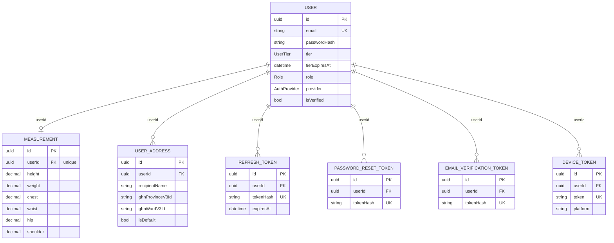
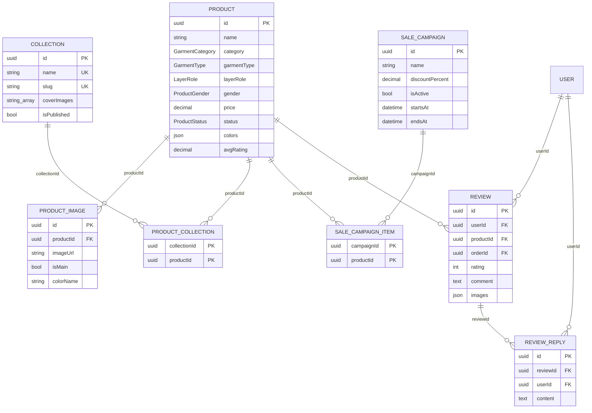
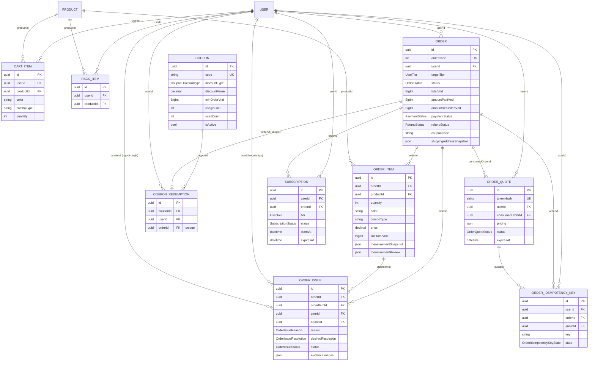
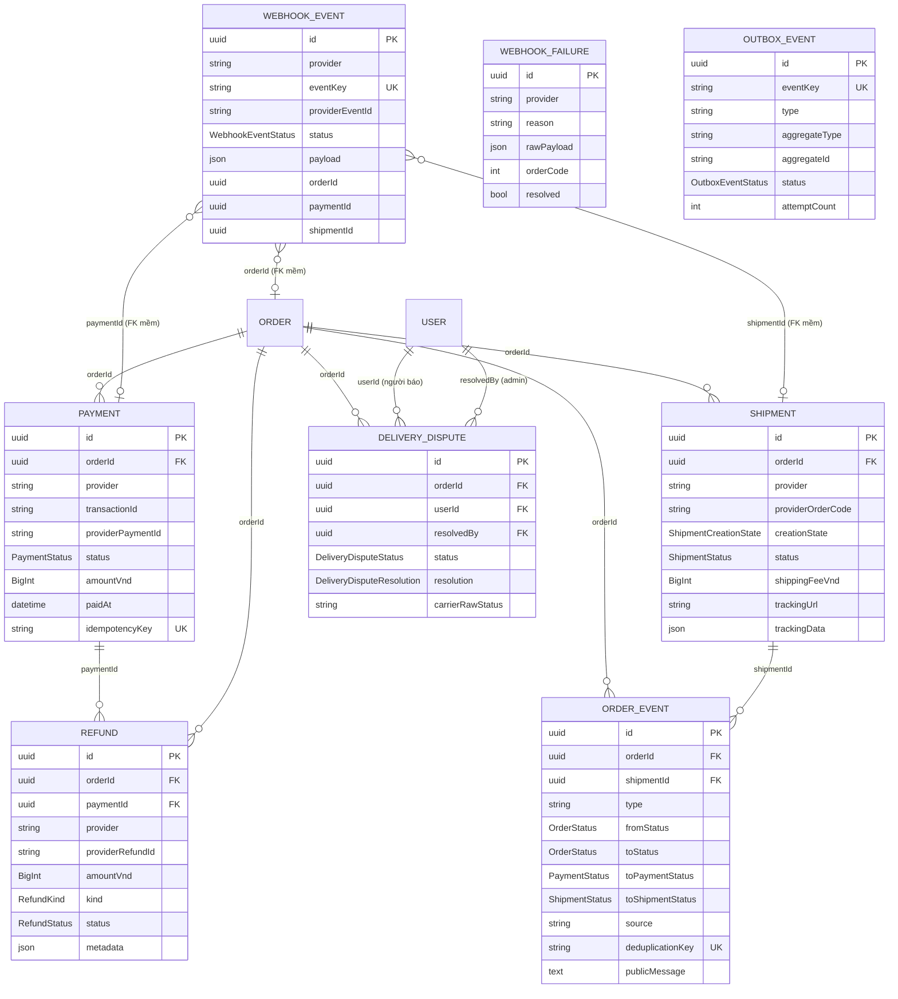
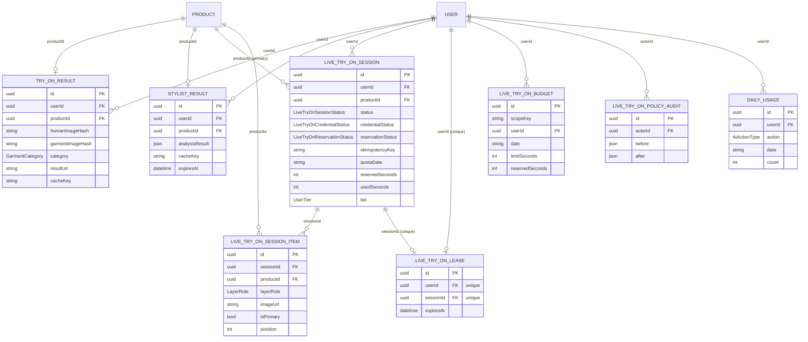
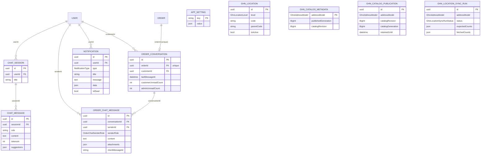

# ERD — FashionAI Backend

Sinh trực tiếp từ `prisma/schema.prisma` (51 model, 34 enum). Quan hệ dưới đây là các
quan hệ khoá ngoại thực tế do Prisma khai báo.

- Bản tương tác (lọc theo nhóm miền, tìm cột, xem quan hệ): `docs/erd.html`
- Bản Mermaid (dùng trong PR/markdown): file này

## 0. Sơ đồ tổng thể — toàn bộ 51 bảng

```mermaid
erDiagram
    %% ===== Danh tính & Xác thực =====
    USER ||--o| MEASUREMENT : "userId"
    USER ||--o{ USER_ADDRESS : "userId"
    USER ||--o{ REFRESH_TOKEN : "userId"
    USER ||--o{ PASSWORD_RESET_TOKEN : "userId"
    USER ||--o{ EMAIL_VERIFICATION_TOKEN : "userId"
    USER ||--o{ DEVICE_TOKEN : "userId"

    %% ===== Danh mục =====
    PRODUCT ||--o{ PRODUCT_IMAGE : "productId"
    PRODUCT ||--o{ PRODUCT_COLLECTION : "productId"
    COLLECTION ||--o{ PRODUCT_COLLECTION : "collectionId"
    PRODUCT ||--o{ SALE_CAMPAIGN_ITEM : "productId"
    SALE_CAMPAIGN ||--o{ SALE_CAMPAIGN_ITEM : "campaignId"
    PRODUCT ||--o{ REVIEW : "productId"
    REVIEW ||--o{ REVIEW_REPLY : "reviewId"
    USER ||--o{ REVIEW : "userId"
    USER ||--o{ REVIEW_REPLY : "userId"

    %% ===== Giỏ hàng & Đơn hàng =====
    USER ||--o{ CART_ITEM : "userId"
    PRODUCT ||--o{ CART_ITEM : "productId"
    USER ||--o{ RACK_ITEM : "userId"
    PRODUCT ||--o{ RACK_ITEM : "productId"
    USER ||--o{ ORDER : "userId"
    ORDER ||--o{ ORDER_ITEM : "orderId"
    PRODUCT ||--o{ ORDER_ITEM : "productId"
    ORDER ||--o{ ORDER_ISSUE : "orderId"
    ORDER_ITEM ||--o{ ORDER_ISSUE : "orderItemId"
    USER ||--o{ ORDER_ISSUE : "userId"
    USER ||--o{ ORDER_ISSUE : "adminId"
    COUPON ||--o{ COUPON_REDEMPTION : "couponId"
    ORDER ||--o| COUPON_REDEMPTION : "orderId"
    USER ||--o{ COUPON_REDEMPTION : "userId"
    USER ||--o{ ORDER_QUOTE : "userId"
    ORDER ||--o{ ORDER_QUOTE : "consumedOrderId"
    USER ||--o{ ORDER_IDEMPOTENCY_KEY : "userId"
    ORDER ||--o{ ORDER_IDEMPOTENCY_KEY : "orderId"
    ORDER_QUOTE ||--o{ ORDER_IDEMPOTENCY_KEY : "quoteId"
    USER ||--o{ SUBSCRIPTION : "userId"
    ORDER ||--o{ SUBSCRIPTION : "orderId"

    %% ===== Thanh toán & Vận chuyển =====
    ORDER ||--o{ PAYMENT : "orderId"
    PAYMENT ||--o{ REFUND : "paymentId"
    ORDER ||--o{ REFUND : "orderId"
    ORDER ||--o{ SHIPMENT : "orderId"
    ORDER ||--o{ ORDER_EVENT : "orderId"
    SHIPMENT ||--o{ ORDER_EVENT : "shipmentId"
    ORDER ||--o{ DELIVERY_DISPUTE : "orderId"
    USER ||--o{ DELIVERY_DISPUTE : "userId"
    USER ||--o{ DELIVERY_DISPUTE : "resolvedBy"
    WEBHOOK_EVENT }o--o| ORDER : "orderId (mềm)"
    WEBHOOK_EVENT }o--o| PAYMENT : "paymentId (mềm)"
    WEBHOOK_EVENT }o--o| SHIPMENT : "shipmentId (mềm)"

    %% ===== AI & Hạn mức =====
    USER ||--o{ TRY_ON_RESULT : "userId"
    PRODUCT ||--o| TRY_ON_RESULT : "productId"
    USER ||--o{ STYLIST_RESULT : "userId"
    PRODUCT ||--o| STYLIST_RESULT : "productId"
    USER ||--o{ LIVE_TRY_ON_SESSION : "userId"
    PRODUCT ||--o{ LIVE_TRY_ON_SESSION : "productId"
    LIVE_TRY_ON_SESSION ||--o{ LIVE_TRY_ON_SESSION_ITEM : "sessionId"
    PRODUCT ||--o{ LIVE_TRY_ON_SESSION_ITEM : "productId"
    USER ||--o| LIVE_TRY_ON_LEASE : "userId"
    LIVE_TRY_ON_SESSION ||--o| LIVE_TRY_ON_LEASE : "sessionId"
    USER ||--o{ LIVE_TRY_ON_BUDGET : "userId"
    USER ||--o{ LIVE_TRY_ON_POLICY_AUDIT : "actorId"
    USER ||--o{ DAILY_USAGE : "userId"

    %% ===== Chat & Thông báo =====
    USER ||--o{ CHAT_SESSION : "userId"
    CHAT_SESSION ||--o{ CHAT_MESSAGE : "sessionId"
    ORDER ||--o| ORDER_CONVERSATION : "orderId"
    USER ||--o{ ORDER_CONVERSATION : "customerId"
    ORDER_CONVERSATION ||--o{ ORDER_CHAT_MESSAGE : "conversationId"
    USER ||--o{ ORDER_CHAT_MESSAGE : "senderId"
    USER ||--o{ NOTIFICATION : "userId"

    USER {
      uuid id PK
      string email UK
      UserTier tier
      Role role
      AuthProvider provider
      bool isVerified
    }
    USER_ADDRESS {
      uuid id PK
      uuid userId FK
      string recipientName
      string ghnProvinceV3Id
      string ghnWardV3Id
    }
    MEASUREMENT {
      uuid id PK
      uuid userId FK,UK
      decimal height
      decimal chest
      decimal waist
      decimal hip
    }
    REFRESH_TOKEN {
      uuid id PK
      uuid userId FK
      string tokenHash UK
      datetime expiresAt
    }
    PASSWORD_RESET_TOKEN {
      uuid id PK
      uuid userId FK
      string tokenHash UK
    }
    EMAIL_VERIFICATION_TOKEN {
      uuid id PK
      uuid userId FK
      string tokenHash UK
    }
    DEVICE_TOKEN {
      uuid id PK
      uuid userId FK
      string token UK
      string platform
    }
    PRODUCT {
      uuid id PK
      string name
      GarmentCategory category
      LayerRole layerRole
      ProductGender gender
      decimal price
      ProductStatus status
    }
    PRODUCT_IMAGE {
      uuid id PK
      uuid productId FK
      string imageUrl
      bool isMain
    }
    COLLECTION {
      uuid id PK
      string name UK
      string slug UK
      bool isPublished
    }
    PRODUCT_COLLECTION {
      uuid collectionId PK,FK
      uuid productId PK,FK
    }
    SALE_CAMPAIGN {
      uuid id PK
      string name
      decimal discountPercent
      bool isActive
    }
    SALE_CAMPAIGN_ITEM {
      uuid campaignId PK,FK
      uuid productId PK,FK
    }
    REVIEW {
      uuid id PK
      uuid userId FK
      uuid productId FK
      uuid orderId FK
      int rating
    }
    REVIEW_REPLY {
      uuid id PK
      uuid reviewId FK
      uuid userId FK
      text content
    }
    CART_ITEM {
      uuid id PK
      uuid userId FK
      uuid productId FK
      string color
      string comboType
      int quantity
    }
    RACK_ITEM {
      uuid id PK
      uuid userId FK
      uuid productId FK
    }
    ORDER {
      uuid id PK
      int orderCode UK
      uuid userId FK
      OrderStatus status
      BigInt totalVnd
      PaymentStatus paymentStatus
      RefundStatus refundStatus
    }
    ORDER_ITEM {
      uuid id PK
      uuid orderId FK
      uuid productId FK
      int quantity
      decimal price
      BigInt lineTotalVnd
    }
    ORDER_ISSUE {
      uuid id PK
      uuid orderId FK
      uuid orderItemId FK
      uuid userId FK
      uuid adminId FK
      OrderIssueStatus status
    }
    COUPON {
      uuid id PK
      string code UK
      CouponDiscountType discountType
      decimal discountValue
      bool isActive
    }
    COUPON_REDEMPTION {
      uuid id PK
      uuid couponId FK
      uuid userId FK
      uuid orderId FK,UK
    }
    ORDER_QUOTE {
      uuid id PK
      string tokenHash UK
      uuid userId FK
      uuid consumedOrderId FK
      OrderQuoteStatus status
    }
    ORDER_IDEMPOTENCY_KEY {
      uuid id PK
      uuid userId FK
      uuid orderId FK
      uuid quoteId FK
      OrderIdempotencyKeyState state
    }
    SUBSCRIPTION {
      uuid id PK
      uuid userId FK
      uuid orderId FK
      UserTier tier
      SubscriptionStatus status
    }
    PAYMENT {
      uuid id PK
      uuid orderId FK
      string provider
      PaymentStatus status
      BigInt amountVnd
    }
    REFUND {
      uuid id PK
      uuid orderId FK
      uuid paymentId FK
      RefundKind kind
      RefundStatus status
      BigInt amountVnd
    }
    SHIPMENT {
      uuid id PK
      uuid orderId FK
      string provider
      string providerOrderCode
      ShipmentStatus status
    }
    ORDER_EVENT {
      uuid id PK
      uuid orderId FK
      uuid shipmentId FK
      string type
      OrderStatus toStatus
    }
    DELIVERY_DISPUTE {
      uuid id PK
      uuid orderId FK
      uuid userId FK
      uuid resolvedBy FK
      DeliveryDisputeStatus status
    }
    WEBHOOK_EVENT {
      uuid id PK
      string provider
      string eventKey UK
      uuid orderId
      uuid paymentId
      uuid shipmentId
    }
    WEBHOOK_FAILURE {
      uuid id PK
      string provider
      string reason
      int orderCode
      bool resolved
    }
    OUTBOX_EVENT {
      uuid id PK
      string eventKey UK
      string type
      string aggregateType
      string aggregateId
    }
    TRY_ON_RESULT {
      uuid id PK
      uuid userId FK
      uuid productId FK
      GarmentCategory category
      string cacheKey
    }
    STYLIST_RESULT {
      uuid id PK
      uuid userId FK
      uuid productId FK
      json analysisResult
      string cacheKey
    }
    LIVE_TRY_ON_SESSION {
      uuid id PK
      uuid userId FK
      uuid productId FK
      LiveTryOnSessionStatus status
      LiveTryOnCredentialStatus credentialStatus
      int reservedSeconds
    }
    LIVE_TRY_ON_SESSION_ITEM {
      uuid id PK
      uuid sessionId FK
      uuid productId FK
      LayerRole layerRole
      bool isPrimary
    }
    LIVE_TRY_ON_LEASE {
      uuid id PK
      uuid userId FK,UK
      uuid sessionId FK,UK
      datetime expiresAt
    }
    LIVE_TRY_ON_BUDGET {
      uuid id PK
      string scopeKey
      uuid userId FK
      string date
      int limitSeconds
    }
    LIVE_TRY_ON_POLICY_AUDIT {
      uuid id PK
      uuid actorId FK
      json before
      json after
    }
    DAILY_USAGE {
      uuid id PK
      uuid userId FK
      AiActionType action
      string date
      int count
    }
    CHAT_SESSION {
      uuid id PK
      uuid userId FK
      string title
    }
    CHAT_MESSAGE {
      uuid id PK
      uuid sessionId FK
      string role
      text content
      json suggestions
    }
    ORDER_CONVERSATION {
      uuid id PK
      uuid orderId FK,UK
      uuid customerId FK
      datetime lastMessageAt
    }
    ORDER_CHAT_MESSAGE {
      uuid id PK
      uuid conversationId FK
      uuid senderId FK
      OrderChatSenderRole senderRole
      text content
    }
    NOTIFICATION {
      uuid id PK
      uuid userId FK
      NotificationType type
      string title
      bool isRead
    }
    APP_SETTING {
      string key PK
      json value
    }
    GHN_LOCATION {
      uuid id PK
      GhnLocationLevel level
      string code
      string parentCode
    }
    GHN_CATALOG_METADATA {
      GhnAddressModel addressModel PK
      BigInt publishedGeneration
      BigInt catalogRevision
    }
    GHN_CATALOG_PUBLICATION {
      uuid id PK
      GhnAddressModel addressModel
      BigInt catalogRevision
      BigInt catalogGeneration
    }
    GHN_LOCATION_SYNC_RUN {
      uuid id PK
      GhnAddressModel addressModel
      GhnLocationSyncRunStatus status
    }
```

`APP_SETTING`, `GHN_LOCATION`, `GHN_CATALOG_METADATA`, `GHN_CATALOG_PUBLICATION`,
`GHN_LOCATION_SYNC_RUN`, `WEBHOOK_FAILURE`, `OUTBOX_EVENT` không có khoá ngoại — chúng
bám vào phần còn lại qua `aggregateId` / `orderCode` / `code` (tham chiếu logic).

## 1. Danh tính & Xác thực

## 2. Danh mục sản phẩm

## 3. Giỏ hàng & Đơn hàng

## 4. Thanh toán, Vận chuyển & Sự kiện

## 5. AI, Phiên Live Try-On & Hạn mức

## 6. Chat, Thông báo & Hạ tầng

## Bảng không có khoá ngoại (standalone)

`AppSetting`, `GhnLocation`, `GhnCatalogMetadata`, `GhnCatalogPublication`,
`GhnLocationSyncRun`, `WebhookFailure`, `OutboxEvent` — liên kết với phần còn lại qua
`aggregateId` / `orderCode` / `code` (tham chiếu logic, không phải FK).
