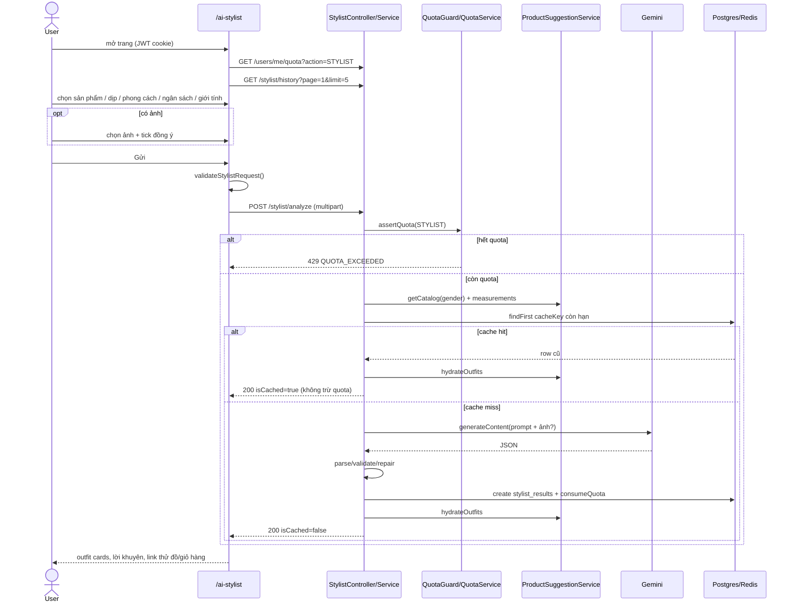

# FLW-004 — AI Stylist (web): tư vấn outfit từ catalog

## Phạm vi

- **Mục tiêu:** người dùng đã đăng nhập nhận một bộ outfit gợi ý chỉ gồm sản phẩm đang bán, kèm phân tích dáng/màu (nếu có ảnh), lời khuyên phối, và đi tiếp được sang thử đồ hoặc giỏ hàng; xem lại/xoá lịch sử tư vấn.
- **Actor:** `USER` đã đăng nhập (tier FREE/MEMBER/VIP). Không có role riêng; admin không có màn hình stylist.
- **Trigger:** mở `/ai-stylist`, gửi form, hoặc mở deep link `?result=<id>`.
- **Preconditions:** JWT hợp lệ; còn quota STYLIST trong ngày (hoặc VIP); `GEMINI_API_KEY` đã cấu hình cho nhánh gọi AI.
- **Postconditions:** một `stylist_results` row được tạo (cache miss) hoặc row cũ được trả lại (cache hit); quota chỉ bị trừ khi gọi provider thành công; kết quả hiển thị và có thể xem lại từ lịch sử.
- **Ngoài phạm vi:** chat AI Stylist trong widget `/chat` (khác module chatbot), thử đồ ảnh/live (FLW-002/003), thanh toán/nâng cấp gói, admin quản trị prompt/model.

## Hệ thống

| Lớp | Thành phần |
|---|---|
| FE routes | `/ai-stylist` — `FE/src/app/(main)/ai-stylist/page.tsx` · `/profile/stylist-history` — `FE/src/app/(main)/profile/stylist-history/page.tsx` |
| FE chính | `FE/src/features/stylist/components/ai-stylist-page.tsx`, `stylist-input-panel.tsx`, `stylist-result-panel.tsx`, `stylist-history-panel.tsx`, `profile-stylist-history-page.tsx`; hooks `useStylist.ts`; services `mutations.ts`, `queries.ts`, `stylist-utils.ts` |
| BE | `BE/src/modules/stylist/stylist.controller.ts`, `stylist.service.ts`; `product-suggestion.service.ts`; `common/guards/quota.guard.ts`; `common/services/quota.service.ts`; `common/pipes/file-validation.pipe.ts` |
| AI | Google Gemini qua `@google/genai`, model `GEMINI_MODEL` (mặc định `gemini-2.0-flash`) |
| DB | `stylist_results`, `daily_usages`, `products` + `product_images`; Redis key `quota:stylist:<userId>:<date>` (fallback in-memory) |
| API | `POST /api/stylist/analyze`, `GET /api/stylist/history`, `GET /api/stylist/history/:id`, `DELETE /api/stylist/history/:id`, `GET /api/users/me/quota?action=STYLIST` |

## Luồng chính

| # | Actor | Screen/API | Action | Business rules | Expected outcome |
|---|---|---|---|---|---|
| 1 | User | SCR-028 `/ai-stylist` | Mở trang | BR-118 | Trang hiển thị; chưa đăng nhập bị đưa sang login |
| 2 | FE | `GET /users/me/quota?action=STYLIST`, `GET /stylist/history` | Tải quota + 5 kết quả gần nhất | BR-119, BR-143, BR-144 | Badge quota và panel lịch sử có dữ liệu |
| 3 | User | SCR-028 | Chọn sản phẩm catalog (tuỳ chọn) | BR-128, BR-131 | Sản phẩm neo được gửi làm `productId` |
| 4 | User | SCR-028 | Nhập dịp/phong cách/ngân sách/giới tính | BR-123, BR-130 | Form hợp lệ; budget chỉ là text gợi ý |
| 5 | User | SCR-028 | Đính ảnh + tick đồng ý | BR-124, BR-125, BR-126, BR-127 | Preview ảnh; submit bị chặn nếu thiếu consent |
| 6 | FE | CMP-061 | Bấm Gửi | BR-123, BR-149, BR-150 | Multipart gửi ảnh/consent đúng điều kiện |
| 7 | BE | `POST /stylist/analyze` | JWT + quota guard | BR-118, BR-119, BR-120 | 401 nếu thiếu token; 429 trước khi gọi provider |
| 8 | BE | `analyzeAndAdvise` | Kiểm tra API key, consent, input tối thiểu | BR-122, BR-123, BR-124 | 503/400 với thông điệp tương ứng |
| 9 | BE | `getCatalog`, cache | Chọn catalog theo gender, tra cache | BR-129, BR-130, BR-140, BR-141 | Cache hit trả ngay, `isCached=true` |
| 10 | BE | Gemini | Gọi model với prompt + ảnh base64 | BR-135, BR-136, BR-137 | JSON đã chuẩn hoá hoặc repair 1 lần |
| 11 | BE | `stylistResult.create` + `consumeQuota` | Lưu kết quả, trừ 1 lượt | BR-139, BR-120 | Row mới; quota +1 sau thành công |
| 12 | BE | `hydrateOutfits` | Ghép sản phẩm thật vào outfit | BR-132, BR-133, BR-134, BR-145 | `outfits` có tên/giá/ảnh/availability |
| 13 | FE | SCR-028 | Render kết quả | BR-148 | Cards outfit + màu + lời khuyên + CTA |
| 14 | User | SCR-028 | Chọn thử đồ / thêm vào giỏ | BR-155 | Điều hướng `/try-on?...` hoặc thêm cart line |
| 15 | User | SCR-028, SCR-029 | Xem lịch sử, mở chi tiết, xoá | BR-143…BR-147, BR-154 | Danh sách phân trang; 404 nếu không sở hữu |
| 16 | User | SCR-028 `?result=<id>` | Mở deep link | BR-153 | Kết quả được khôi phục và URL chuẩn hoá |

## Alternate / exception paths

| # | Điều kiện | Kết quả |
|---|---|---|
| A1 | Không có JWT | Middleware/guard chặn; API 401 `UNAUTHORIZED` |
| A2 | Hết quota ngày | 429 `QUOTA_EXCEEDED` trước provider; FE mở modal nâng cấp |
| A3 | Thiếu `GEMINI_API_KEY` | 503 `GEMINI_NOT_CONFIGURED` |
| A4 | Ảnh không có consent / consent `'false'` | 400; Gemini không được gọi |
| A5 | Không ảnh, không product, không text context | 400 |
| A6 | File sai MIME hoặc >10 MB | 400 từ `FileValidationPipe` |
| A7 | `productId` không tồn tại | 404; chưa trừ quota |
| A8 | Gemini trả JSON hỏng/thiếu field | Repair 1 lần; vẫn lỗi → 502 `GEMINI_INVALID_RESPONSE` |
| A9 | Gemini 429 / lỗi API key | 429 hoặc 401 tương ứng |
| A10 | Cache hit | 200 `isCached=true`; không gọi Gemini, không trừ quota |
| A11 | History id của người khác | 404 (không lộ dữ liệu) |
| A12 | `page`/`limit` xấu | `limit` bị kẹp 1..100; `page` không validate (BUG-051) |

## Câu hỏi mở

OQ-018…OQ-023 — xem `09-audit.md`.

## Bằng chứng

Code-verified: controller/service/DTO, FE page/services/components, schema, quota constants. Test evidence: `05-execution.md`. Không chạy Gemini/Postgres/browser thật.
