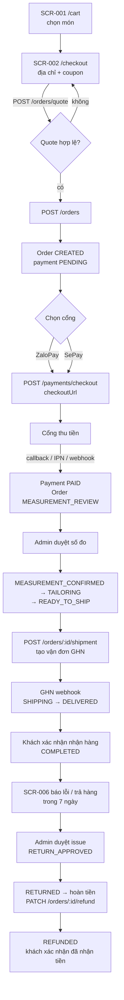

# FLW-001 — Đặt hàng → Thanh toán → Giao hàng → Đổi trả/Hoàn tiền

Bộ tài liệu traceability cho luồng thương mại chính (BE + FE), sinh ngày 2026-11-18 từ
source code tại `FashionAI_BE/` và `FashionAI_FE/`. Mọi ID là duy nhất trong bộ tài liệu
này; tham chiếu chéo dùng ID đầy đủ.

- Evidence class: **Code-verified** cho toàn bộ luồng chính; các điểm chưa xác minh ghi `Unknown`.
- Nguồn ý định (intent): `SRS.md`, `ARCHITECTURE.md`, `plans/order-*.md`, `docs/adr/*`. Khi tài
  liệu và code lệch nhau, giữ nguyên yêu cầu trong SRS và ghi discrepancy ở `09-audit.md`.

## Phạm vi

### FLW-001 — Luồng đặt may và hậu mãi

- **Goal**: khách chọn món may đo, nhận báo giá do server tính (giá + phí GHN), thanh toán
  online, theo dõi sản xuất/giao hàng, xác nhận nhận hàng và yêu cầu đổi trả/hoàn tiền trong
  cửa sổ 7 ngày.
- **Actors / roles**: Guest (chỉ xem), Customer (JWT), Admin (`Role.ADMIN`), System (cron,
  webhook ZaloPay/SePay/GHN, outbox worker).
- **Trigger**: khách bấm “Đặt hàng” ở `/checkout`, hoặc webhook thanh toán/vận chuyển từ đối tác.
- **Preconditions**: tài khoản đã đăng nhập; hồ sơ có đủ số đo bắt buộc theo `garmentType`
  của từng món; địa chỉ giao hàng tồn tại và map được sang catalog GHN 2 cấp; Admin đã cấu
  hình địa chỉ lấy hàng GHN.
- **Postconditions (happy path)**: `Order.status = COMPLETED`, `paymentStatus = PAID`, có
  `OrderEvent` cho từng mốc, khách nhận email/thông báo, `amountRefundedVnd = 0`.
- **Postconditions (hoàn tiền)**: `Order.refundStatus = COMPLETED`, `paymentStatus` là
  `PAID | PARTIALLY_REFUNDED | REFUNDED` tuỳ số đã hoàn, khách xác nhận đã nhận tiền
  (`refundConfirmedAt`).

### Hệ thống trong phạm vi

| Lớp | Thành phần | Neo |
|---|---|---|
| FE routes | `/cart`, `/checkout`, `/payment/result`, `/orders/[id]`, `/orders/[id]/returns`, `/profile/orders`, `/admin/orders`, `/admin/orders/[id]`, `/admin/shipments`, `/admin/reconciliation` | `FashionAI_FE/src/app/**/page.tsx` |
| FE features | `features/cart`, `features/checkout`, `features/payments`, `features/orders`, `features/admin` | `FashionAI_FE/src/features/*` |
| BE modules | `cart`, `orders`, `payments` (+`zalopay`, `sepay`), `shipping` (+`providers/ghn`), `order-issues`, `outbox`, `notification`, `mail`, `sale-campaigns` | `FashionAI_BE/src/modules/*` |
| DB tables | `Order`, `OrderItem`, `OrderEvent`, `OrderIdempotencyKey`, `Payment`, `Refund`, `Shipment`, `WebhookEvent`, `OrderIssue`, `Coupon`, `CouponRedemption`, `SaleCampaign*`, `OutboxEvent` | `FashionAI_BE/prisma/schema.prisma` |
| Đối tác ngoài | ZaloPay (cổng + callback), SePay (IPN + bank webhook), GHN (fee, tạo vận đơn, webhook) | `src/modules/payments/{zalopay,gateways}`, `src/modules/shipping/providers/ghn` |

### Trong phạm vi

- Đặt đơn sản phẩm may đo (không gồm đơn mua gói thành viên — xem ghi chú OQ-004).
- Báo giá, coupon, sale campaign, phí vận chuyển, tạo đơn, thanh toán online, xác nhận thanh toán.
- Vòng đời đơn sau thanh toán: duyệt số đo, may, tạo vận đơn, đồng bộ trạng thái GHN.
- Xác nhận nhận hàng, báo chưa nhận hàng, đổi trả/hoàn tiền.
- Công cụ admin: cập nhật trạng thái, tạo/hủy vận đơn, duyệt issue, hoàn tiền, đối soát.

### Ngoài phạm vi

- Đăng ký/đăng nhập, hồ sơ số đo (chỉ dùng như precondition).
- Try-on, stylist, chatbot, avatar.
- Mua gói thành viên (ZaloPay/SePay cho subscription, proration, huỷ gia hạn) — chỉ ghi nhận
  điểm giao thoa ở BR-021.
- Blog, collection, rack, thông báo push ở mức chi tiết.

## Luồng chính

## Các bước end-to-end

| # | Actor | Screen / API | Action | Business rules | Expected outcome |
|---|---|---|---|---|---|
| 1 | Customer | SCR-001 `/cart` · `GET/POST/PATCH/DELETE /cart*` (API-001…006) | Thêm/sửa/xoá món, chọn màu/kích cỡ | BR-001, BR-043 | Giỏ hiển thị đúng giá hiện hành; món ngừng bán bị loại khỏi đơn |
| 2 | Customer | SCR-002 `/checkout` · `GET /shipping/address-catalog/*` (API-036, API-037), `GET /users/me/addresses` (API-050) | Chọn địa chỉ, nhập ghi chú | BR-008, BR-009 | Địa chỉ map được sang `ghnProvinceV3Id` / `ghnWardV3Id` |
| 3 | Customer | `POST /orders/quote` (API-008) | Báo giá | BR-001, BR-003…BR-008 | `itemsTotal`, `shippingFee`, `discountAmount`, `totalAmount`, `quoteToken` |
| 4 | Customer | `POST /orders` (API-007) | Đặt hàng | BR-002…BR-012 | `Order` CREATED, payment PENDING, `OrderItem` snapshot |
| 5 | Customer | `POST /payments/checkout` (API-025) | Tạo link thanh toán | BR-016, BR-017 | `checkoutUrl` + `orderCode`; đơn giữ CREATED |
| 6 | Gateway | `POST /payments/zalopay/callback`, `/payments/sepay-ipn`, `/payments/sepay-webhook` (API-026…028) | Xác nhận thu tiền | BR-017…BR-022 | Payment PAID, order → MEASUREMENT_REVIEW, giỏ được dọn, thông báo + email |
| 7 | Admin | SCR-010 `/admin/orders/[id]` · `PATCH /orders/:id/status` (API-018) | Duyệt số đo, chuyển may | BR-014, BR-015, BR-024 | MEASUREMENT_CONFIRMED → TAILORING → READY_TO_SHIP |
| 8 | Admin | SCR-010 · `POST /orders/:id/shipment` (API-019) | Tạo vận đơn GHN | BR-025 | `Shipment` CREATED, `providerOrderCode` |
| 9 | GHN | `POST /webhooks/shipping/ghn` (API-042) | Báo trạng thái | BR-027, BR-028 | Shipment SHIPPING/DELIVERED; order tiến tương ứng |
| 10 | Customer | SCR-007 `/orders/[id]` · `POST /orders/:id/confirm-delivery` (API-023) | “Tôi đã nhận hàng” | BR-029 | Order COMPLETED |
| 11 | Customer | SCR-008 `/orders/[id]/returns` · `POST /orders/:orderId/items/:itemId/issues` (API-043) | Báo lỗi + ảnh + STK | BR-031, BR-032 | `OrderIssue` PENDING, order RETURN_REQUESTED |
| 12 | Admin | SCR-010 / SCR-013 · `PATCH /order-issues/:issueId/review` (API-048) | Duyệt/từ chối | BR-035, BR-038 | Issue APPROVED/REJECTED, refund REQUIRED |
| 13 | Admin | SCR-010 · `PATCH /orders/:id/refund` (API-021) | Chốt chuyển khoản + ảnh chứng từ | BR-033…BR-036 | `Refund` COMPLETED, `paymentStatus` cập nhật |
| 14 | Customer | SCR-007 · `POST /orders/:id/refund/confirm-received` (API-022) | Xác nhận đã nhận tiền | BR-037 | `refundConfirmedAt` set |

## Đường thay thế / ngoại lệ

| Mã | Tình huống | Hành vi kỳ vọng | Neo |
|---|---|---|---|
| ALT-01 | Khách hủy đơn trước khi trả tiền | Chỉ `CREATED` + `PENDING`; payment placeholder → EXPIRED; coupon được trả | `orders.service.ts:cancel:510` |
| ALT-02 | Đơn không thanh toán quá 24 giờ | Cron hủy `CANCELLED`, `paymentStatus EXPIRED`, trả coupon, báo khách | `orders.service.ts:expireUnpaidOrders:571` |
| ALT-03 | Cổng báo thu nhưng sai số tiền / sai `requestId` / đơn đã xử lý | Không ghi PAID; payment → `REFUND_REQUIRED`, ghi `WebhookFailure` | `payments.service.ts:applyGatewayPaymentResult:504` |
| ALT-04 | Cổng báo thất bại/hết hạn | Payment → FAILED, đơn vẫn CREATED để thanh toán lại | `payments.service.ts:applyGatewayPaymentResult:587` |
| ALT-05 | GHN giao thất bại / hoàn hàng | Shipment giữ `DELIVERY_FAILED`/`RETURNING`; order không tự nhảy trạng thái | `shipment-order-status.util.ts:orderStatusForShipment:22` |
| ALT-06 | Khách báo chưa nhận hàng khi hãng đã báo giao | Order DELIVERY_DISPUTED trong 7 ngày; admin xử lý COMPLETED/CANCELLED | `orders.service.ts:createDeliveryDispute:1644` |
| ALT-07 | Admin từ chối issue | Issue REJECTED kèm `adminNote` bắt buộc; order giữ trạng thái | `order-issues.service.ts:review:391` |
| ALT-08 | Khách báo chưa nhận được tiền hoàn | Mở lại khoản hoàn đã COMPLETED trong 7 ngày; refund cũ → FAILED | `orders.service.ts:reopenRefundNotReceived:1375` |
| ALT-09 | Admin “Duyệt & hoàn ngay” | Cần mã giao dịch + ≥1 ảnh chứng từ; order → RETURNED | `order-issues.service.ts:review:420` |

## Câu hỏi mở

| ID | Câu hỏi | Ảnh hưởng |
|---|---|---|
| OQ-001 | SRS còn mô tả COD và trừ/hoàn kho, nhưng code không có cột stock và `create()` từ chối COD. Yêu cầu nào là chuẩn? | BR-010, BUG-001 |
| OQ-002 | `OrderQuote` và các cột `OrderIdempotencyKey.state/expiresAt` tồn tại trong schema nhưng không được dùng — có kế hoạch bật lại không? | 09-audit |
| OQ-003 | `OrderStatus.EXPIRED`, `PENDING`, `CONFIRMED`, `QUALITY_CHECK`, `RETURNING` không có writer; giữ trong enum để tương thích dữ liệu cũ hay sẽ bỏ? | BR-014 |
| OQ-004 | Mua gói thành viên dùng chung `Order` + webhook; có cần bộ traceability riêng không? | Ngoài phạm vi |
| OQ-005 | `UpdateOrderStatusDto.source` cho phép admin ghi đè nguồn sự kiện (`USER`/`SYSTEM`) — đây có phải chủ đích audit? | BUG-004 |
