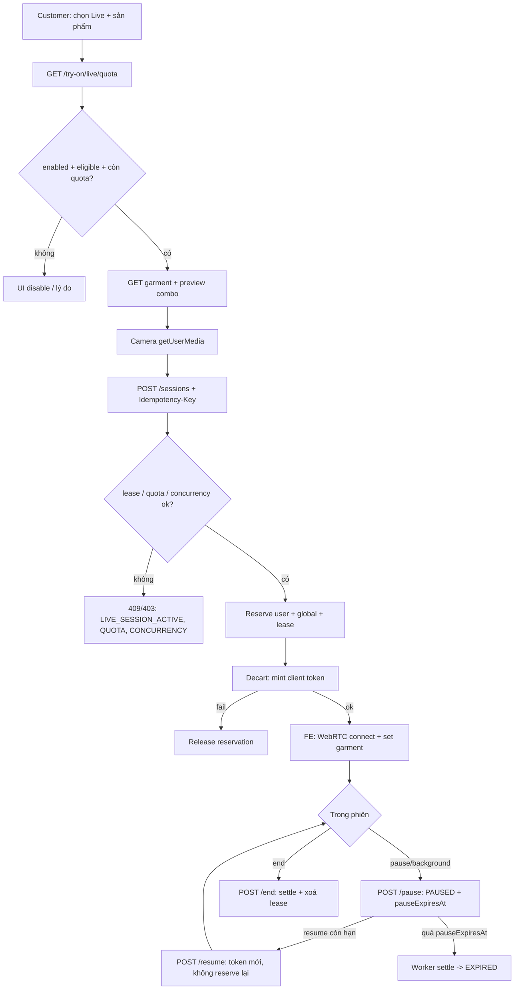

# FLW-003 — Live Try-On (Decart realtime): Web FE + BE

- **Mục tiêu:** Khách đủ điều kiện mở phiên thử đồ realtime với một hoặc nhiều món (tối đa 3 lớp), dùng quota theo giây, tạm dừng/tiếp tục/kết thúc mà không mất phần thời gian còn lại; admin cấu hình policy theo gói.
- **Actors / roles:** Customer (FREE/MEMBER/VIP), Admin, BE, Decart Lucy provider, DB (Postgres), worker reconcile.
- **Trigger:** Customer chọn tab “Live Try-On” trong `/try-on` và bấm bắt đầu; hoặc resume phiên PAUSED còn hạn.
- **Preconditions:** Đã đăng nhập; feature `enabled`; tier được bật; còn quota; không có lease active; sản phẩm ACTIVE + category được bật + ảnh garment đọc được; đã cấp quyền camera.
- **Postconditions:** Session ở ACTIVE/ENDED/EXPIRED/FAILED; budget user/global được settle đúng một lần; lease được xoá khi kết thúc/hết hạn; credential chỉ lộ một lần.
- **Systems:**
  - FE web: `src/features/try-on/**`, route `/try-on`, admin panel `admin-live-try-on-settings-panel.tsx`.
  - BE: `src/modules/try-on/live-try-on.controller.ts`, `live-try-on.service.ts`, `decart-realtime.service.ts`, `garment-combo.util.ts`, `live-combo.util.ts`, `admin-settings.service.ts`, cron `reconcileExpiredSessions`.
  - DB: `live_try_on_sessions`, `live_try_on_session_items`, `live_try_on_budgets`, `live_try_on_leases`, `live_try_on_policy_audits`, `app_settings`.
  - Provider: Decart `POST /v1/client/tokens`, WebRTC realtime.
- **Trong phạm vi:** web FE live workspace + BE quota/policy/session/lease/worker + admin policy.
- **Ngoài phạm vi:** mobile live screen (`FashionAI_Mobile`), FASHN ảnh, billing provider thật, signaling proxy.
- **Evidence:** Code-verified trên `FashionAI_BE` + `FashionAI_FE`; Documented từ `plans/decart-lucy-live-try-on-flow-and-business-rules.md` và `plans/live-try-on-quota-admin-and-pause-plan.md`.
- **Open questions:** OQ-012…OQ-017.

## Luồng chính

Caption: dựng từ `live-try-on.controller.ts:14-116`, `live-try-on.service.ts:178-408`, `use-live-try-on.ts:67-216`; trạng thái/budget theo `schema.prisma:651-764`.

## Các bước end-to-end

| # | Actor | Screen / API | Hành động | Business rules | Kết quả quan sát |
|---|---|---|---|---|---|
| 1 | Customer | SCR-026 `/try-on` · API-056 | Mở tab Live | BR-082, BR-083 | UI hiện quota giây, lý do disable nếu có |
| 2 | Customer | SCR-026 · API-057, API-058 | Chọn 1 món hoặc phối bộ, xem preview | BR-084…BR-089 | Ảnh tham chiếu + prompt; chưa tiêu quota |
| 3 | Customer | SCR-026 | Cấp quyền camera | BR-090 | Preview local; không có quyền → lỗi rõ ràng |
| 4 | Customer | API-059 | Bắt đầu phiên | BR-091…BR-097 | 200 + token một lần, `remainingSeconds` |
| 5 | BE | Transaction Serializable | Reserve user/global + lease | BR-098…BR-101 | Budget reserved, lease active |
| 6 | BE | Decart API | Mint token | BR-102, BR-103 | Token TTL + max duration; lỗi → release |
| 7 | Customer | SCR-026 | Xem video, timer | BR-104, BR-105 | Countdown theo `remainingSeconds`, first-frame guard |
| 8 | Customer | API-061 | Pause/background | BR-106…BR-108 | PAUSED, usedSeconds chốt, pauseExpiresAt |
| 9 | Customer | API-062 | Resume | BR-109…BR-111 | Token mới; không reserve thêm; đổi món chỉ khi pause |
| 10 | Customer | API-063 | End | BR-112…BR-114 | ENDED; budget allocated = used; lease xoá |
| 11 | Worker | Cron mỗi phút | Settle phiên hết hạn | BR-115, BR-116 | Reserved → allocated; EXPIRED; lease xoá |
| 12 | Admin | SCR-027 · API-064, API-065 | Sửa policy/audit | BR-117, BR-082 | Version tăng, audit ghi before/after |

## Đường thay thế / ngoại lệ

| ID | Tình huống | Hành vi | Neo |
|---|---|---|---|
| ALT-01 | Feature/tier tắt | Quota trả `enabled=false`, `limit=0`; không cấp token | `live-try-on.service.ts:getQuota:110-153`, `assertEnabledAndEligible:851` |
| ALT-02 | User hết hạn gói | `eligible=false`, lý do `subscription_expired` | `getEligibility:858-862` |
| ALT-03 | Sản phẩm sai UUID/không ACTIVE/thiếu ảnh | 400/404 với code tương ứng | `resolveLiveProduct:678-690` |
| ALT-04 | Ảnh garment không đọc được/sai content-type | `LIVE_GARMENT_UNREADABLE` / `LIVE_GARMENT_BAD_CONTENT_TYPE` | `assertGarmentUrlReadable:834-849` |
| ALT-05 | Combo sai lớp (FULL_BODY + món khác, trùng lớp, >3) | 400, message tiếng Việt | `garment-combo.util.ts:layerCombinationError:17-38` |
| ALT-06 | Idempotency key trùng khác body | `409 IDEMPOTENCY_BODY_MISMATCH` | `createSession:187-205` |
| ALT-07 | Cùng key đang ISSUING/đã ISSUED | `409 SESSION_PENDING` / `SESSION_ALREADY_ISSUED`, không replay token | `createSession:198-204` |
| ALT-08 | Còn lease active | `409 LIVE_SESSION_ACTIVE` + `blockedUntil` | `createSession:206-209` |
| ALT-09 | Hết slot đồng thời | `403 LIVE_CONCURRENCY_EXCEEDED` | `reserveSessionTx:537-545` |
| ALT-10 | Không đủ giây tối thiểu | `LIVE_SESSION_BUDGET_TOO_LOW` | `reserveSessionTx:568-572` |
| ALT-11 | Provider lỗi khi mint token | 502; reservation + lease được release | `createSession:230-238`, `releaseFailedReservation:619-638` |
| ALT-12 | Resume khi pause hết hạn | `409 LIVE_PAUSE_EXPIRED` | `resumeSession:298-303` |
| ALT-13 | Resume khi hết giây | `409 LIVE_SESSION_EXHAUSTED` | `resumeSession:305-308` |
| ALT-14 | Pause/End lặp | Pause trả trạng thái hiện tại; End idempotent theo reservation | `pauseSession:269`; `endSession:372-405` |
| ALT-15 | Session hết `blockedUntil` | Worker settle 50 phiên/lần; lỗi migration được log và bỏ qua | `reconcileExpiredSessions:476-510` |

## Ghi chú phạm vi

- Trạng thái DB có `PAUSING/RESUMING/ENDING` nhưng service không dùng; FE có trạng thái UI cùng tên.
- Web dùng direct WebRTC; không có proxy ký signaling, nên client sửa được catalog/prompt (đã ghi trong plan §11) — xem OQ-016.
- Mobile live dùng cùng BE nhưng không nằm trong ma trận này.
