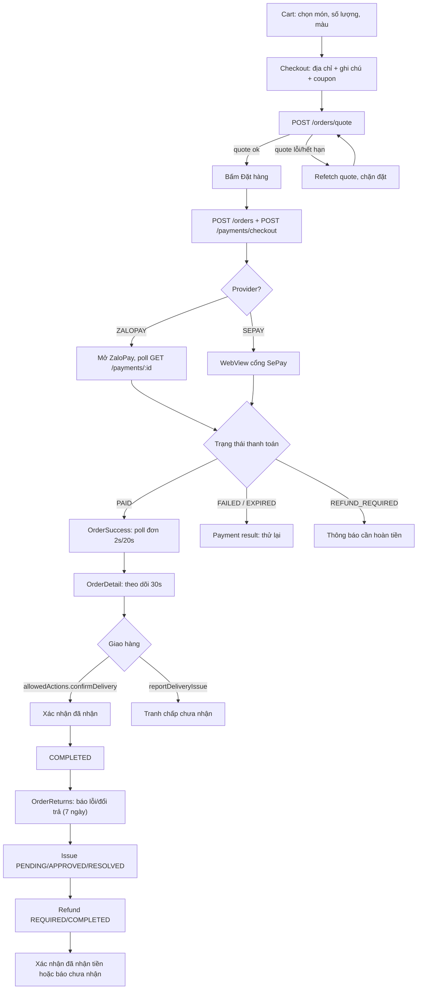

# FLW-002 — Mobile: Đặt hàng → Thanh toán → Giao hàng → Đổi trả/Hoàn tiền

- **Mục tiêu:** Khách hoàn tất mua hàng trên app Expo/React Native, theo dõi đơn, xác nhận giao hàng và xử lý đổi trả/hoàn tiền với các quyết định của máy chủ.
- **Actors / roles:** Customer (đã đăng nhập), hệ thống BE (`FashionAI_BE`), GHN, cổng thanh toán ZaloPay/SePay, notification service (Expo push/socket).
- **Trigger:** Khách bấm “Thanh toán” từ giỏ hàng (`CartScreen`) hoặc “Thanh toán lại” từ chi tiết đơn.
- **Preconditions:** Có JWT hợp lệ; giỏ có ít nhất 1 dòng; đủ số đo theo loại trang phục; có địa chỉ map được GHN 2 cấp.
- **Postconditions:** `Order` + `Payment` tồn tại; giỏ được dọn sau thanh toán; đơn đi qua state machine của BE; issue/refund có bản ghi và trạng thái cuối.
- **Systems:**
  - Mobile: `src/features/cart`, `checkout`, `payments`, `orders`, `shipping`, `notifications`; navigation `src/navigation/root-navigator.tsx`, `profile-stack.tsx`.
  - BE: `POST /orders/quote`, `POST /orders`, `POST /payments/checkout`, `GET /payments/:id`, `GET /orders*`, `PATCH /orders/:id/cancel|status`, `POST /orders/:id/confirm-delivery|delivery-dispute|refund/confirm-received`, `POST /orders/:orderId/items/:itemId/issues`, `GET /order-issues/*`, GHN webhook.
  - DB: `Order`, `OrderItem`, `Payment`, `Refund`, `OrderIssue`, `LiveTryOnSession` không thuộc flow này.
- **Trong phạm vi:** mobile UI + client rules cho mua hàng, thanh toán, theo dõi, hủy, xác nhận giao, tranh chấp, báo lỗi/đổi trả, hoàn tiền, thông báo dẫn tới đúng màn.
- **Ngoài phạm vi:** web/admin, luồng mua gói thành viên (chỉ dùng chung `PaymentScreen`), live try-on, chat sau bán (chỉ nhắc tới khi điều hướng).
- **Evidence:** Code-verified cho mobile (`594f275`, 2026-11-15) + BE docs `FLW-001`; Documented cho rules lấy từ `FashionAI_BE/docs/traceability/checkout-to-delivery`.
- **Open questions:** OQ-006, OQ-007, OQ-008, OQ-009, OQ-010, OQ-011.

## Luồng chính

Caption: dựng từ `CartScreen`, `CheckoutScreen`, `PaymentScreen`, `OrderSuccessScreen`, `OrderDetailScreen`, `OrderReturnsScreen`; API theo `src/constants/endpoints.ts:87-121`.

## Các bước end-to-end

| # | Actor | Screen / API | Hành động | Business rules | Kết quả quan sát |
|---|---|---|---|---|---|
| 1 | Customer | SCR-017 `/Cart` · API-001…005 | Sửa/xoá dòng, chọn màu | BR-043 (BE) | Giỏ server là nguồn sự thật; badge/tổng cập nhật |
| 2 | Customer | SCR-018 `/Checkout` · API-050, API-051, API-036, API-037 | Chọn địa chỉ đã lưu hoặc nhập địa chỉ mới | BR-009 (BE), BR-046 | Địa chỉ có `ghnProvinceV3Id` / `ghnWardV3Id` |
| 3 | Customer | SCR-018 · API-008 | Nhập ghi chú/coupon, chờ quote | BR-001, BR-004…BR-008 (BE), BR-045, BR-077, BR-078 | Tổng tiền, phí ship, giảm giá chỉ lấy từ server |
| 4 | Customer | SCR-018 · API-052 | Hệ thống kiểm tra cổng số đo | BR-003 (BE), BR-047 | Thiếu số đo thì chặn đặt và chỉ màn bổ sung |
| 5 | Customer | SCR-018 · API-007 | Bấm “Đặt hàng” | BR-011 (BE), BR-055 | `Order` CREATED; mobile chưa gửi idempotency key |
| 6 | Customer | SCR-018 · API-025 | Tạo link thanh toán ngay sau khi tạo đơn | BR-016 (BE), BR-049 | `checkoutUrl`/`qrCode`, `paymentId` |
| 7 | Customer | SCR-019 `/Payment` | Mở ZaloPay hoặc WebView SePay | BR-050…BR-054 | Poll/URL trả về trạng thái; UI chỉ chuyển khi PAID |
| 8 | Customer | SCR-024 `/OrderSuccess` · API-010 | Chờ xác nhận thanh toán | BR-051, BR-056 | Poll 2s tối đa 20s; PAID → “Thành công” |
| 9 | Customer | SCR-020 `/Orders` · API-009 | Lọc tab, tìm mã đơn | BR-057 | Danh sách phân trang theo trạng thái |
| 10 | Customer | SCR-021 `/OrderDetail` · API-010, API-011 | Xem tiến trình, tracking | BR-058, BR-060, BR-074 | Tự refetch 30s khi đơn chưa kết thúc |
| 11 | Customer | SCR-021 · API-012 | Hủy đơn chưa thanh toán | BR-013 (BE), BR-059 | Chỉ hiện khi `allowedActions.cancel` |
| 12 | Customer | SCR-021 · API-023 | “Tôi đã nhận hàng” | BR-029 (BE), BR-060 | Order COMPLETED |
| 13 | Customer | SCR-021 · API-016 | Báo chưa nhận hàng | BR-030 (BE), BR-061 | Order DELIVERY_DISPUTED; cần mô tả ≥10 ký tự |
| 14 | Customer | SCR-022 `/OrderReturns` · API-043 | Báo lỗi/đổi trả kèm ảnh + STK | BR-031…BR-033 (BE), BR-062…BR-064 | Issue PENDING; order RETURN_REQUESTED |
| 15 | Customer | SCR-022, SCR-023· API-044, API-046, API-047 | Theo dõi issue/refund | BR-065, BR-072, BR-073 | Trạng thái issue/refund và chứng từ hiển thị |
| 16 | Customer | SCR-021, SCR-022 · API-022 | Xác nhận đã nhận tiền hoặc báo chưa nhận | BR-037 (BE), BR-065, BR-066 | `refundConfirmedAt` hoặc issue REFUND_NOT_RECEIVED |
| 17 | Customer | SCR-025 `/Notifications` | Bấm push/socket về đơn/đổi trả | BR-069 | Điều hướng đúng `OrderDetail`/`OrderReturns`/`Returns` |

## Đường thay thế / ngoại lệ

| ID | Tình huống | Hành vi | Neo |
|---|---|---|---|
| ALT-01 | Quote hết hạn hoặc tổng đổi | Chặn đặt, refetch, báo “Báo giá đã thay đổi” | `CheckoutScreen.tsx:handlePlaceOrder:545-660`; error `QUOTE_EXPIRED`/`QUOTE_CHANGED` |
| ALT-02 | Địa chỉ đã đổi version | Refetch sổ địa chỉ + quote, báo địa chỉ vừa cập nhật | `CheckoutScreen.tsx:handleRetryQuote`; error `ADDRESS_VERSION_CONFLICT` |
| ALT-03 | Thiếu số đo | Alert liệt kê số đo thiếu; nút đặt bị chặn | `CheckoutScreen.tsx:559-580`, `measurementsGate` |
| ALT-04 | ZaloPay đóng/huỷ | Result “Thanh toán đã bị hủy”, đơn vẫn chờ thanh toán | `PaymentScreen.tsx:180-210`, `handleHoldOrder` |
| ALT-05 | SePay trả URL có “success” | Mobile coi là PAID ngay, không hỏi backend | `PaymentScreen.tsx:handleWebViewNavigation:380-405` (defect candidate BUG-022) |
| ALT-06 | Cổng trả REFUND_REQUIRED | Màn “Khoản thanh toán cần hoàn lại”, không có retry | `PaymentScreen.tsx:406-430` |
| ALT-07 | Đơn hết hạn thanh toán (24h) | Order EXPIRED; tab “Chờ thanh toán” không còn đơn | BE BR-012; `order-status.ts:24` |
| ALT-08 | Khách báo chưa nhận khi GHN đã báo giao | Tranh chấp mở 7 ngày, admin xử lý | BE BR-030; `OrderDetailScreen.tsx:836-850` |
| ALT-09 | Quá 7 ngày từ COMPLETED | Nút báo lỗi biến mất; BE vẫn là chốt cuối | `order-returns.ts:canReportOrderIssue:161-171` |
| ALT-10 | Mất mạng khi đặt hàng | Alert lỗi; không có idempotency key nên retry có thể tạo đơn thứ hai | `orders.api.ts:createOrder:92-94`; BUG-023 |
| ALT-11 | Đơn có issue/refund | OrderDetail chỉ còn thẻ tóm tắt, chi tiết ở `OrderReturns` | `OrderDetailScreen.tsx:532-538` |
| ALT-12 | Push không có orderId | Mở danh sách Returns thay vì crash | `order-notification-target.ts:17-29` |

## Ghi chú phạm vi

- Mobile không có màn admin; mọi quyết định duyệt issue/refund nằm ở BE/admin.
- PaymentScreen dùng chung cho mua gói thành viên; các nhánh `targetTier`/`returnRoute` được ghi nhận nhưng không thuộc FLW-002.
- Mobile dùng chung endpoint với web; ID API tham chiếu bộ `checkout-to-delivery` để không nhân đôi entity.
