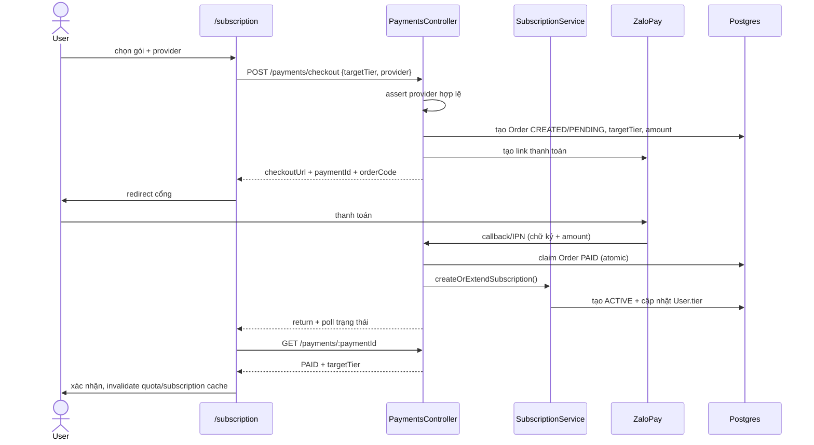

# FLW-005 — Mua / gia hạn gói thành viên (subscription)

## Phạm vi

- **Mục tiêu:** user mua mới, gia hạn, nâng cấp giữa kỳ hoặc hẹn hạ gói; thanh toán qua ZaloPay/SePay; quyền lợi tier và quota AI được cấp đúng sau khi cổng xác nhận.
- **Actor:** `USER` đã đăng nhập; hệ thống thanh toán (SePay/ZaloPay) gọi webhook; admin hoàn tiền (chỉ ở nhánh refund).
- **Trigger:** bấm "Nâng cấp"/"Gia hạn" ở `/subscription`, hoặc mở link nhắc gia hạn.
- **Preconditions:** JWT; gói đích MEMBER/VIP; provider ZaloPay/SePay; không có `SCHEDULED` đang chờ (nếu mua gói mới).
- **Postconditions:** Order `PAID`; đúng một dòng `ACTIVE` (hoặc `SCHEDULED` cho downgrade); `User.tier`/`tierExpiresAt` khớp; quota AI đọc theo tier mới; payment/refund idempotent.
- **Ngoài phạm vi:** đơn sản phẩm (FLW-001), hoàn tiền sản phẩm, admin duyệt số đo, auto-charge định kỳ (hệ thống **không** tự trừ tiền).

## Hệ thống

| Lớp | Thành phần |
|---|---|
| FE routes | `/subscription`; `/payment/success`, `/payment/result`, `/payment/error`, `/payment/cancel` |
| FE chính | `features/subscription/components/subscription-page.tsx`, `subscription-plans.tsx`, `current-subscription.tsx`, `subscription-history.tsx`; hooks `useSubscription.ts`; payment `features/payments/*` |
| BE | `payments.controller.ts`, `payments.service.ts`, `subscription.service.ts`; `subscription-plans.constants.ts`; gateway registry/ZaloPay/SePay |
| DB | `orders`, `payments`, `subscriptions`, `refunds`, `users`, `daily_usages`; partial unique index một `ACTIVE`/user |
| Jobs | cron nhắc gia hạn trước 3 ngày, lock Redis, tạo order + email |
| API | checkout, plans, subscriptions me/history/cancel/resume/scheduled-cancel, payment status, webhook SePay/ZaloPay |

## Luồng chính — mua mới bằng ZaloPay

| # | Actor | Screen/API | Action | Business rules | Expected outcome |
|---|---|---|---|---|---|
| 1 | User | SCR-030 `/subscription` | Mở bảng giá | BR-157 | 3 gói + giá/quota từ API |
| 2 | FE | `GET /payments/plans` | Tải giá public | BR-157, BR-158 | Giá 0/34k/99k, 30 ngày |
| 3 | User | SCR-030 | Đăng nhập, xem gói hiện tại | BR-156, BR-185 | Tier, hạn, auto-renew, lịch hẹn |
| 4 | User | SCR-030 | Chọn MEMBER/VIP + ZaloPay/SePay | BR-158, BR-160 | Nút thanh toán khả dụng |
| 5 | FE | `POST /payments/checkout` | Gửi `targetTier`, provider | BR-156, BR-161 | 200 `checkoutUrl`, `orderCode`, `kind=SUBSCRIPTION` |
| 6 | BE | `createCheckoutLink` | Chặn FREE/MoMo trước khi tạo order | BR-159, BR-160, BR-162 | 400, không có order rác |
| 7 | BE | `createSubscriptionOrder` | Kiểm tra lịch hẹn, tính proration | BR-163, BR-169 | Order PENDING đúng giá |
| 8 | User | Gateway | Thanh toán | BR-164 | Redirect về success/error/cancel |
| 9 | Gateway | webhook SePay/ZaloPay | Gửi callback đã ký | BR-166 | Chữ ký/amount hợp lệ |
| 10 | BE | `handleGatewayCallback` | Claim order atomic | BR-167, BR-173 | Chỉ một luồng thắng |
| 11 | BE | `createOrExtendSubscription` | Phân loại NEW/RENEWAL/UPGRADE/DOWNGRADE | BR-168…BR-172 | Tier/hạn đúng, một ACTIVE |
| 12 | BE | notification/outbox | Báo thành công | BR-177 | Thông báo đúng mode |
| 13 | FE | `/payment/success` | Poll order/payment 20 s | BR-193 | Hiển thị PAID hoặc đang xác nhận |
| 14 | FE | `invalidateAfterPayment` | Xoá cache subscription/quota | BR-193 | Trang gói hiển thị hạn mới |
| 15 | User | SCR-030 | Tắt/bật nhắc, huỷ lịch hẹn | BR-187…BR-189 | Giữ quyền đến hết hạn |
| 16 | Admin | refund flow | Hoàn toàn bộ đơn gói | BR-180…BR-184 | Thu hồi đúng phần quyền lợi |

## Alternate / exception paths

| # | Điều kiện | Kết quả |
|---|---|---|
| A1 | Chưa đăng nhập | `me/history/checkout` 401; bảng giá vẫn public |
| A2 | Chọn FREE | 400, không tạo order |
| A3 | Chọn MoMo | 400 trước khi tạo order |
| A4 | Đang có `SCHEDULED` | 409; phải huỷ lịch trước |
| A5 | Cùng tier còn hạn | RENEWAL: +30 ngày từ hạn cũ |
| A6 | Upgrade giữa kỳ | Trả net proration, hiệu lực ngay, hạn giữ theo quote |
| A7 | Quote >24h / gói đã đổi / hết hạn | Cấp số ngày theo số tiền đã trả (1…30) |
| A8 | Downgrade | Tạo SCHEDULED, chỉ kích hoạt khi gói hiện tại hết hạn |
| A9 | Webhook trùng | Trả thành công, không cấp/thu lần hai |
| A10 | Amount/signature sai | Từ chối, ghi webhook failure, không đổi tier |
| A11 | Hoàn một phần | Không thu hồi quyền lợi |
| A12 | Hoàn toàn bộ | Huỷ gói/khôi phục gói cũ, hạ tier nếu cần |
| A13 | Hết hạn không gia hạn | Cron hạ về FREE; không tự trừ tiền |

## Câu hỏi mở

OQ-024…OQ-029 — xem `09-audit.md`.
